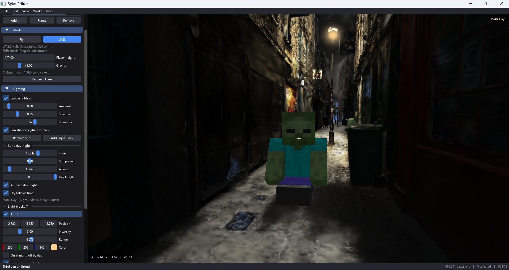

# Splat Editor: A 3D Gaussian Splatting Viewer and Editor 

Official implementation of **Splat Editor**, a viewer and editor for 3D Gaussian Splatting (`.ply`) files, written in Python + OpenGL 3.3 with a Dear ImGui interface.



## Abstract

We present **Splat Editor**, a lightweight desktop tool that turns trained 3D Gaussian Splatting scenes into something you can edit and walk through. It loads large binary PLY files through memory mapping, keeps the frame rate stable with level-of-detail (LOD) culling and background depth sorting, and adds an editing layer (layers, brush selection, deletion, undo, merged export). On top of the rendered scene it provides a **walk mode** with gravity and collision against a voxel grid built from the gaussians, a third-person avatar, and a lighting system with a sun, point lights, shadow mapping and a day-night cycle.

## Key Features

- **Large Scenes**: binary PLY files are memory-mapped, LOD caps the number of gaussians drawn per frame, and depth sorting runs on a background thread.
- **View-Dependent Color**: spherical harmonics of degree 1 to 3 (`f_rest_*`), toggled from the View menu.
- **Layers**: each file is a layer with its own position, rotation and scale; drop `.ply` files onto the window to add them.
- **Editing**: selection brush, select all / none / invert, delete, undo, and saving the visible layers merged into one `.ply`.
- **Lighting**: ambient, a sun, up to 8 point-light blocks, Phong shading, shadow mapping, and a day-night cycle.
- **Walk Mode**: gravity and collision against a voxel grid built from the gaussians, plus a third-person avatar with walking, sitting and gesture animations.

## Method Overview

Splat Editor separates the data model from rendering so that editing and physics never depend on OpenGL:

1. **IO Layer**: reads and writes the standard 3DGS PLY layout and decodes the raw columns (position, SH coefficients, opacity, scale, rotation).
2. **Core Model**: layers, scene, undo history, LOD, spherical harmonics, lighting and physics. No OpenGL dependency.
3. **Editor**: editing operations and the selection brush, which selects through all depths (hidden gaussians are selected too).
4. **Renderer**: shader-based splat rendering with a background depth sorter, shadow pass, floor grid, light gizmos and avatar.
5. **UI**: GLFW window, Dear ImGui panels, mouse and keyboard handling.

```
┌─────────────────────────────────────────────────────────────┐
│                   Splat Editor Pipeline                      │
├─────────────────────────────────────────────────────────────┤
│  .ply files ──► IO (mmap + decode) ──► Layers / Scene       │
│                                            │                │
│                       ┌────────────────────┼───────────┐    │
│                       ▼                    ▼           ▼    │
│                  LOD culling          Editor/Brush   Physics│
│                       │               (select, undo) (voxel │
│                       ▼                    │         grid)  │
│               Background depth sort        │           │    │
│                       │                    │           │    │
│                       ▼                    ▼           ▼    │
│        Splat renderer + shadows + lights + avatar           │
│                       │                                     │
│                       ▼                                     │
│              ImGui UI ──► Window (GLFW)                     │
└─────────────────────────────────────────────────────────────┘
```

## Requirements

### Installation

Requires Python 3.10 or newer and a graphics card that supports OpenGL 3.3.

```bash
git clone https://github.com/KietAnhCS/SplatOpenGL.git
cd SplatOpenGL

python -m venv .venv
.venv\Scripts\activate        # Windows
# source .venv/bin/activate   # Linux / macOS

pip install -r requirements.txt
```

### Preparation

The repo does not ship a sample `.ply`. Use the output of any 3DGS training tool, in the standard 3DGS PLY layout: `x y z`, `f_dc_*`, `f_rest_*`, `opacity`, `scale_*`, `rot_*`.

If the scene appears upside down (COLMAP data), enable **View > Flip Y Axis**.

## Getting Started

### Open a Scene

```bash
python main.py                  # empty window, press Ctrl+O to pick a file
python main.py scene.ply        # open a file directly
python main.py a.ply b.ply      # open several files, one layer each
```

`python -m splat_editor [file.ply]` works as well.

### Controls

Press **F1** in the app for the full shortcut list.

#### Camera

| Input | Action |
| --- | --- |
| Left drag | Orbit around the target |
| Right drag | Look around (fly mode) |
| Middle drag | Pan |
| `W` `A` `S` `D` | Fly forward / left / back / right |
| `Space` / `Shift` | Fly up / down |
| `Ctrl` | Fly faster |
| `F` | Frame the whole scene |
| `G` | Show / hide the floor grid |

#### File and Editing

| Key | Action |
| --- | --- |
| `Ctrl+O` | Open a file (replaces the scene) |
| `Ctrl+I` | Add files to the scene as new layers |
| `Ctrl+S` | Save the visible layers merged into one `.ply` |
| `Ctrl+Z` | Undo the last delete |
| `Ctrl+A` / `Ctrl+D` | Select all / select none |
| `Delete` | Delete the picked light, otherwise the selected gaussians |
| `Ctrl+Q` | Exit |

#### Selection Brush

| Input | Action |
| --- | --- |
| `B` | Toggle the brush |
| Left drag | Select gaussians |
| `Ctrl` + left drag | Deselect gaussians |
| `[` / `]` | Smaller / larger brush |
| `Esc` | Turn the brush off |

The brush selects through all depths: gaussians hidden behind others are selected too.

#### Walk Mode and Lighting

| Key | Action |
| --- | --- |
| `M` | Switch Fly / Walk |
| `W` `A` `S` `D` | Walk |
| `Space` / `Ctrl` / `Shift` | Jump / sprint / sneak |
| `F5` | First person, behind, in front |
| `C` | Sit down / stand up |
| `V` / `X` / `Y` | Wave / zombie arms / cheer |
| `L` | Drop a light block in front of the camera |

The sun, shadows, time of day and other lighting parameters live in the **Lighting** section of the left panel.

## Repository Structure

```
SplatOpenGL/
├── main.py                   # entry point
├── requirements.txt
├── pyproject.toml
├── splat_editor/
│   ├── app.py                # Application class: wiring, main loop, action registry
│   ├── core/                 # data model, no OpenGL: layers, scene, undo, LOD, SH, lighting, physics
│   ├── io/                   # PLY reading/writing and decoding of the 3DGS columns
│   ├── editor/               # editing operations and the selection brush
│   ├── render/               # OpenGL: shaders, camera, splat rendering, floor grid, lights, avatar
│   │   └── shaders/          # GLSL sources
│   └── ui/                   # GLFW window, Dear ImGui, mouse and keyboard
├── docs/                     # slides (SplatEditor.pptx) and report (main.pdf)
├── report/                   # LaTeX report (English and Vietnamese) with figures
└── assets/                   # README images
```

## Documentation

- Report: [`docs/main.pdf`](docs/main.pdf)
- Slides: [`docs/SplatEditor.pptx`](docs/SplatEditor.pptx)

## Acknowledgements

This work builds upon:
- [3D Gaussian Splatting for Real-Time Radiance Field Rendering](https://github.com/graphdeco-inria/gaussian-splatting)
- [Dear ImGui](https://github.com/ocornut/imgui) via [imgui-bundle](https://github.com/pthom/imgui_bundle)
- [GLFW](https://www.glfw.org/) and [PyOpenGL](https://pyopengl.sourceforge.net/)

## License

MIT, see [LICENSE](LICENSE).

## Contact

For questions about this implementation, please open an issue on [GitHub](https://github.com/KietAnhCS/SplatOpenGL/issues).
