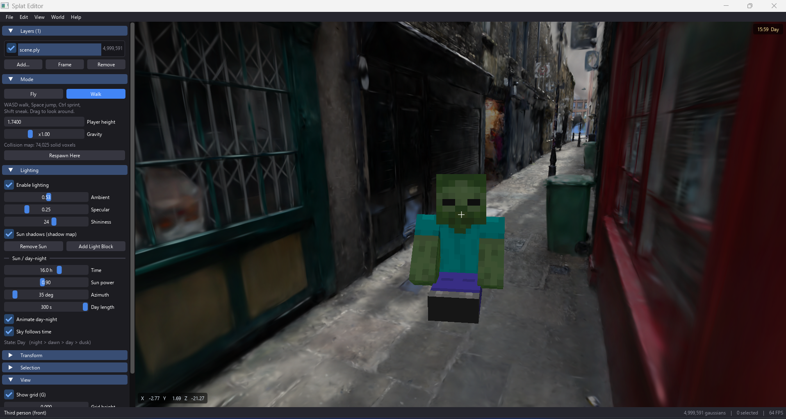

# Splat Editor

A viewer and editor for 3D Gaussian Splatting (`.ply`) files, written in Python + OpenGL 3.3 with a Dear ImGui interface. Besides viewing and trimming gaussians, you can walk around inside the scene as a player, with lighting, shadows and a day-night cycle.



## Features

- **Large scenes**: binary PLY files are memory-mapped, LOD caps the number of gaussians drawn per frame, and depth sorting runs on a background thread.
- **View-dependent color**: spherical harmonics of degree 1 to 3 (`f_rest_*`), toggled from the View menu.
- **Layers**: each file is a layer with its own position, rotation and scale; drop `.ply` files onto the window to add them.
- **Editing**: selection brush, select all / none / invert, delete, undo, and saving the visible layers merged into one `.ply`.
- **Lighting**: ambient, a sun, up to 8 point-light blocks, Phong shading, shadow mapping, and a day-night cycle.
- **Walk mode**: gravity and collision against a voxel grid built from the gaussians, plus a third-person avatar with walking, sitting and gesture animations.

## Installation

Requires Python 3.10 or newer and a graphics card that supports OpenGL 3.3.

```
git clone https://github.com/KietAnhCS/SplatOpenGL.git
cd SplatOpenGL
pip install -r requirements.txt
```

## Running

```
python main.py                  # empty window, press Ctrl+O to pick a file
python main.py scene.ply        # open a file directly
python main.py a.ply b.ply      # open several files, one layer each
```

`python -m splat_editor [file.ply]` works as well.

The repo does not ship a sample `.ply`. Use the output of any 3DGS training tool (the standard 3DGS PLY layout: `x y z`, `f_dc_*`, `f_rest_*`, `opacity`, `scale_*`, `rot_*`). If the scene appears upside down (COLMAP data), enable **View > Flip Y Axis**.

## Controls

Press **F1** in the app for the full shortcut list.

### Camera

| Input | Action |
| --- | --- |
| Left drag | Orbit around the target |
| Right drag | Look around (fly mode) |
| Middle drag | Pan |
| `W` `A` `S` `D` | Fly forward / left / back / right |
| `Space` / `Shift` | Fly up / down |
| `Ctrl` | Fly faster |
| `F` | Frame the whole scene |
| `G` | Show / hide the floor grid |

### File and editing

| Key | Action |
| --- | --- |
| `Ctrl+O` | Open a file (replaces the scene) |
| `Ctrl+I` | Add files to the scene as new layers |
| `Ctrl+S` | Save the visible layers merged into one `.ply` |
| `Ctrl+Z` | Undo the last delete |
| `Ctrl+A` / `Ctrl+D` | Select all / select none |
| `Delete` | Delete the picked light, otherwise the selected gaussians |
| `Ctrl+Q` | Exit |

### Selection brush

| Input | Action |
| --- | --- |
| `B` | Toggle the brush |
| Left drag | Select gaussians |
| `Ctrl` + left drag | Deselect gaussians |
| `[` / `]` | Smaller / larger brush |
| `Esc` | Turn the brush off |

The brush selects through all depths: gaussians hidden behind others are selected too.

### Walk mode and lighting

| Key | Action |
| --- | --- |
| `M` | Switch Fly / Walk |
| `W` `A` `S` `D` | Walk |
| `Space` / `Ctrl` / `Shift` | Jump / sprint / sneak |
| `F5` | First person, behind, in front |
| `C` | Sit down / stand up |
| `V` / `X` / `Y` | Wave / zombie arms / cheer |
| `L` | Drop a light block in front of the camera |

The sun, shadows, time of day and other lighting parameters live in the **Lighting** section of the left panel.

## Project structure

```
main.py                 entry point
splat_editor/
  app.py                Application class: wires everything together, main loop, action registry
  core/                 data model, no OpenGL dependency: layers, scene, undo, LOD, SH, lighting, physics
  io/                   PLY reading/writing and decoding of the 3DGS columns
  editor/               editing operations and the selection brush
  render/               OpenGL: shaders, camera, splat rendering, floor grid, lights, avatar
    shaders/            GLSL sources
  ui/                   GLFW window, Dear ImGui, mouse and keyboard
report/                 LaTeX report (English and Vietnamese) with figures
```

## License

MIT, see [LICENSE](LICENSE).
